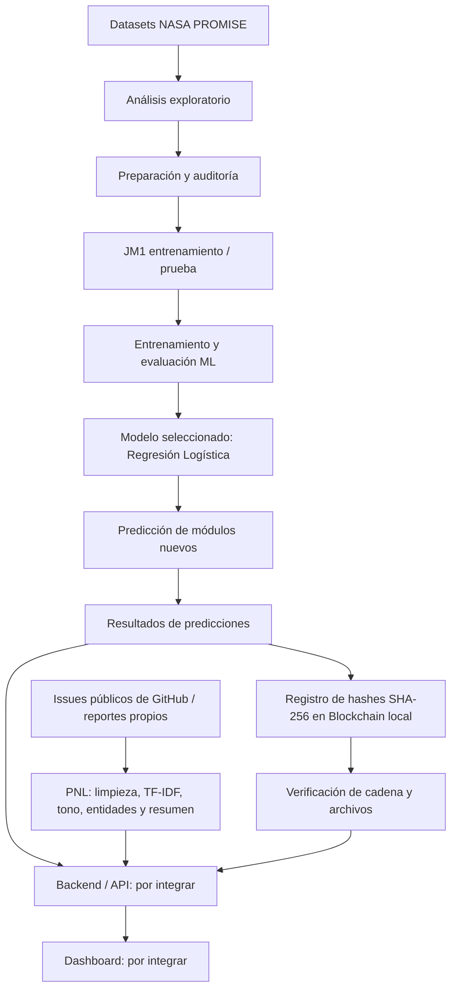

# Sistema inteligente para el análisis y predicción de defectos en proyectos de software

**Proyecto integrador de Inteligencia Artificial en la Ciencia de Datos · Tema 8**  
**Estado:** componentes de análisis/preparación de datos, Machine Learning (ML), Procesamiento de Lenguaje Natural (PNL) y Blockchain desarrollados y probados individualmente; **integración con el backend y dashboard pendiente**.

Repositorio: https://github.com/jesuslara1305/iacienciadatos

> **Alcance:** prototipo académico. Su objetivo es apoyar la identificación de módulos de software con posibles defectos, analizar reportes textuales y comprobar la integridad de resultados. No sustituye pruebas de software, inspección de código ni un sistema de calidad de producción.

## Índice

1. [Descripción del proyecto](#1-descripción-del-proyecto)
2. [Responsabilidades y estado del desarrollo](#2-responsabilidades-y-estado-del-desarrollo)
3. [Arquitectura y flujo de información](#3-arquitectura-y-flujo-de-información)
4. [Estructura del repositorio](#4-estructura-del-repositorio)
5. [Requisitos y configuración del entorno](#5-requisitos-y-configuración-del-entorno)
6. [Inicio rápido para ejecutar los componentes](#6-inicio-rápido-para-ejecutar-los-componentes)
7. [Etapa 1: adquisición y análisis exploratorio](#7-etapa-1-adquisición-y-análisis-exploratorio)
8. [Etapa 2: preparación de datos](#8-etapa-2-preparación-de-datos)
9. [Etapa 3: Machine Learning](#9-etapa-3-machine-learning)
10. [Etapa 4: Procesamiento de Lenguaje Natural](#10-etapa-4-procesamiento-de-lenguaje-natural)
11. [Etapa 5: Blockchain](#11-etapa-5-blockchain)
12. [Guía de integración para el backend de Peruano](#12-guía-de-integración-para-el-backend-de-peruano)
13. [Pruebas y criterios de aceptación](#13-pruebas-y-criterios-de-aceptación)
14. [Errores frecuentes y soluciones](#14-errores-frecuentes-y-soluciones)
15. [Limitaciones, seguridad y buenas prácticas](#15-limitaciones-seguridad-y-buenas-prácticas)
16. [Documentación, evidencias y siguientes pasos](#16-documentación-evidencias-y-siguientes-pasos)
17. [Fuentes y referencias](#17-fuentes-y-referencias)

---

## 1. Descripción del proyecto

El proyecto busca desarrollar un sistema que **analice métricas históricas de módulos de software para clasificar cuáles podrían presentar defectos**. Se complementa con un componente para analizar reportes escritos de errores y otro para registrar y verificar la integridad de las predicciones mediante hashes SHA-256 enlazados en una Blockchain local.

Se trabaja con dos fuentes **independientes**:

- **NASA PROMISE / MDP:** registros estructurados con 21 métricas numéricas por módulo y una etiqueta histórica de defectos. Sirven para entrenar y evaluar ML.
- **Incidencias públicas de GitHub:** reportes escritos de errores, utilizados para demostrar PNL. **No existe una correspondencia verificada registro a registro entre estos reportes y los módulos de NASA PROMISE.**

El entregable 1 (análisis del problema) ya fue elaborado por Sara y **no se modificó** al construir estas etapas técnicas.

### Objetivo práctico del sistema

1. Adquirir, inspeccionar y preparar datos de módulos de software.
2. Comparar modelos supervisados para estimar la presencia/ausencia de defectos.
3. Analizar textos técnicos mediante limpieza, TF-IDF, reglas de sentimiento, extracción de entidades y resúmenes.
4. Registrar predicciones relevantes y permitir verificar si cambian sus archivos o registros.
5. Presentar los resultados mediante un prototipo y un dashboard, **todavía en integración**.

## 2. Responsabilidades y estado del desarrollo

| Parte | Responsable | Estado |
|---|---|---|
| Análisis del problema (Entregable 1) | Sara | Elaborado, conservado sin cambios |
| Análisis exploratorio y preparación de datos | Responsable de datos/ML/PNL/Blockchain | Ejecutado y documentado |
| Machine Learning (Entregable 3) | Responsable de ML | Tres modelos entrenados; modelo final y pruebas disponibles |
| PNL (Entregable 4) | Responsable de PNL | Funcional; 180 reportes reales procesados localmente y pruebas aprobadas |
| Blockchain (Entregable 5) | Responsable de Blockchain | Registro, validación y detección de alteraciones probados localmente |
| Prototipo, backend y dashboard | Peruano | **Pendiente de conectar** con los componentes publicados |
| Documentación técnica y exposición | Equipo | Documentación acumulativa disponible; completar evidencias de integración |

**Importante:** que las pruebas de los componentes pasen en una computadora no demuestra automáticamente que el backend o la interfaz estén integrados. Esta distinción se mantiene en toda la documentación.

## 3. Arquitectura y flujo de información



**Flujo de ML:** métricas nuevas (21 columnas) → carga del pipeline guardado → predicción `0` o `1` → resultado en CSV/JSON → registro opcional en Blockchain.

**Flujo de PNL:** título y descripción de una incidencia → limpieza/tokenización → análisis heurístico del tono y entidades → resumen estructurado. El corpus completo también se puede representar con TF-IDF para obtener términos relevantes.

**Flujo Blockchain:** CSV de predicciones y, opcionalmente, archivo del modelo → SHA-256 → bloque enlazado → comparación posterior de hashes → integridad o alteración detectada.

## 4. Estructura del repositorio

La estructura principal publicada es:

```text
iacienciadatos/
├── analizar_datasets.py              # Etapa 1: diagnóstico exploratorio
├── descargar_datasets.py             # Descarga no destructiva de CSV NASA PROMISE
├── preparar_datos.py                 # Etapa 2: normalización, auditoría y división
├── diagnostico_inicial_verificado.md
├── datos_originales/                 # cm1, jm1, kc1, kc2 y pc1 originales
├── resultados/                       # Diagnóstico EDA y gráficas
├── resultados_diagnostico/           # Resúmenes y comparación de columnas
├── datos_preparados/
│   ├── cm1_preparado.csv
│   ├── jm1_preparado.csv
│   ├── kc1_preparado.csv
│   ├── kc2_preparado.csv
│   ├── pc1_preparado.csv
│   ├── jm1_entrenamiento.csv
│   ├── jm1_prueba.csv
│   ├── *_auditoria.csv
│   ├── jm1_division.json
│   ├── jm1_mapa_particiones.csv
│   ├── manifiesto_preparacion.json
│   └── reporte_preparacion.md
├── pruebas/
│   └── probar_preparacion.py
├── Etapa_3_ML/
│   ├── entrenar_modelos.py
│   ├── predecir_modulo.py
│   ├── pruebas_ml.py
│   ├── requirements.txt
│   ├── modelos/
│   │   ├── modelo_defectos.joblib
│   │   ├── modelo_metadata.json
│   │   └── modelo_*.joblib
│   ├── ejemplos/ejemplo_nuevos_modulos.csv
│   ├── resultados_ml/
│   └── documentacion_ml/
├── Etapa_4_PNL/
│   ├── descargar_reportes.py
│   ├── analizar_pnl.py
│   ├── analizar_texto.py
│   ├── pnl_core.py
│   ├── requirements.txt
│   ├── .gitignore
│   ├── ejemplos/reportes_sinteticos.csv
│   ├── datos_textuales/
│   ├── resultados_ejemplo/
│   ├── pruebas/probar_pnl.py
│   └── documentacion/
├── Etapa_5_Blockchain/
│   ├── blockchain.py
│   ├── blockchain_core.py
│   ├── datos/                         # Cadena local de registros, si está presente
│   ├── evidencias/
│   ├── ejemplos/
│   └── pruebas/probar_blockchain.py
└── documentacion/                    # Documentos técnicos del proyecto
```

Los archivos y subcarpetas de resultados pueden variar según qué ejecuciones se hayan compartido. **La carpeta `Etapa_4_PNL/resultados_reales/` y `Etapa_4_PNL/datos_textuales/*.csv` están excluidas por el `.gitignore` de PNL**: no se deben dar por disponibles al clonar, aunque existan en la computadora del responsable.

Para conocer el propósito exacto de cada script, también están los README particulares en `Etapa_3_ML/`, `Etapa_4_PNL/` y `Etapa_5_Blockchain/`.

## 5. Requisitos y configuración del entorno

### 5.1 Software

- **Python:** 3.10 o superior para los scripts de PNL y Blockchain. Para **cargar el modelo `.joblib` incluido**, se recomienda reproducir el entorno usado para guardarlo (ver siguiente punto).
- **Versiones del modelo publicado:** el archivo `Etapa_3_ML/modelos/modelo_metadata.json` registra Python **3.13.5**, `scikit-learn` **1.8.0**, `pandas` **2.2.3**, `numpy` **2.3.5** y `joblib` **1.5.3** en el entrenamiento documentado. Comprueba los metadatos de tu propia copia antes de instalar versiones concretas.
- `pip` para instalar las bibliotecas.
- Git, para clonar y actualizar el proyecto.
- VS Code o cualquier editor (opcional).
- Internet para clonar y para descargar incidencias públicas, **no** para probar ML/Blockchain con archivos existentes ni PNL con los ejemplos incluidos.

**No hacen falta Node.js, Docker, una base de datos o un servidor web para ejecutar los componentes actuales.** Eso podría cambiar cuando se incorpore el backend/dashboard.

### 5.2 Bibliotecas empleadas

| Parte | Dependencias relevantes |
|---|---|
| Análisis y preparación | `pandas`, `numpy`, `matplotlib`, `scikit-learn` |
| ML | `pandas`, `numpy`, `scikit-learn`, `joblib`, `matplotlib` |
| PNL | `pandas`, `numpy`, `scikit-learn`, `matplotlib` |
| Blockchain | Biblioteca estándar de Python (`hashlib`, `json`, `csv`, `pathlib`, etc.) |

**No existe un `requirements.txt` único en la raíz del repositorio.** Para la operación principal se instalan los de ML y PNL. Blockchain no requiere paquetes externos adicionales.

### 5.3 Instalación desde cero en Windows (PowerShell)

```powershell
git clone https://github.com/jesuslara1305/iacienciadatos.git
cd .\iacienciadatos

# Recomendado: aislar las dependencias del proyecto.
python -m venv .venv
.\.venv\Scripts\Activate.ps1

python -m pip install --upgrade pip
python -m pip install -r ".\Etapa_3_ML\requirements.txt"
python -m pip install -r ".\Etapa_4_PNL\requirements.txt"

python --version
python -m pip show scikit-learn pandas numpy joblib
```

Si PowerShell bloquea la activación de `.venv`, **no es necesario cambiar la política global de ejecución**. Ejecuta directamente `\.venv\Scripts\python.exe` en lugar de `python` en todos los comandos posteriores.

Si el archivo `.joblib` genera un error de compatibilidad, consulta `modelo_metadata.json` y utiliza una versión de Python y `scikit-learn` compatible con el archivo. En un entorno compatible de Python, puede instalarse la versión registrada con:

```powershell
python -m pip install "scikit-learn==1.8.0"
```

Este comando es pertinente **solo si** los metadatos del archivo que se intenta cargar indican `1.8.0`; no debe asumirse que cualquier nueva versión del modelo tendrá esa misma dependencia. **Evita reentrenar antes de verificar Blockchain**, ya que el hash del `.joblib` registrado cambiaría si sus bytes se modifican.

### 5.4 Si ya tienes el repositorio clonado

Abre PowerShell en la carpeta principal, por ejemplo `C:\Users\jesus\OneDrive\Escritorio\Proyecto IACD`, y utiliza directamente los comandos de las secciones siguientes. No es obligatorio clonar de nuevo.

## 6. Inicio rápido para ejecutar los componentes

Ejecutar **desde la raíz del proyecto**, con las dependencias ya instaladas:

```powershell
# 1) Verificar datos/modelo y reproducibilidad de predicciones.
python ".\Etapa_3_ML\pruebas_ml.py"

# 2) Hacer nuevas predicciones SIN sobrescribir el CSV ya registrado en Blockchain.
python ".\Etapa_3_ML\predecir_modulo.py" --archivo ".\Etapa_3_ML\ejemplos\ejemplo_nuevos_modulos.csv" --salida ".\Etapa_3_ML\resultados_ml\predicciones_verificacion.csv"

# 3) Analizar un reporte textual nuevo.
python ".\Etapa_4_PNL\analizar_texto.py" --titulo "Error en Windows" --descripcion "La aplicacion falla al ejecutar app.py con HTTP 500"

# 4) Pruebas de PNL (sin conexión).
python -m unittest discover -s ".\Etapa_4_PNL\pruebas" -p "probar_*.py" -v

# 5) Verificar la cadena registrada, si datos/cadena.json está disponible.
python ".\Etapa_5_Blockchain\blockchain.py" verificar

# 6) Pruebas de Blockchain (sin alterar la cadena registrada).
python -m unittest discover -s ".\Etapa_5_Blockchain\pruebas" -p "probar_*.py" -v
```

**Resultados esperados:** `CORRECTO` en ML, JSON con análisis en PNL, `Ran 8 tests ... OK` en cada conjunto PNL/Blockchain y `"integro": true` en la cadena existente. Si aún no existe `datos/cadena.json`, sigue la sección 11 para crear **una cadena independiente de prueba**, sin tocar evidencias anteriores.

## 7. Etapa 1: adquisición y análisis exploratorio

### 7.1 Fuente y archivos

Datos de software del repositorio recopilatorio [NASA PROMISE Dataset Repository](https://github.com/ApoorvaKrisna/NASA-promise-dataset-repository), conjuntos **CM1, JM1, KC1, KC2 y PC1**. Se utilizaron archivos CSV. El análisis inicial detectó su estructura, clases, duplicados exactos, grupos con métricas iguales y etiquetas contradictorias, atípicos y valores faltantes.

| Dataset | Registros originales | Con defectos | Duplicados exactos |
|---|---:|---:|---:|
| CM1 | 498 | 49 | 56 |
| JM1 | 13,204 | 2,103 | 4,296 |
| KC1 | 2,109 | 326 | 897 |
| KC2 | 522 | 107 | 147 |
| PC1 | 1,109 | 77 | 155 |
| **Total** | **17,442** | **2,662** | **5,551** |

- Los cinco datasets tienen **21 métricas numéricas y una columna de defectos**.
- En el diagnóstico ejecutado no se reportaron celdas faltantes en métricas ni valores infinitos.
- La etiqueta original de KC2 se denomina `problems` (`yes`/`no`); en otros archivos se utiliza `defects` (`true`/`false`).
- JM1 tenía **88 grupos de vectores de métricas con etiquetas contradictorias**; estos casos se documentaron y no se trataron como duplicados exactos.
- Hay desbalance de clases: en JM1 original, cerca del **15.9 %** tiene etiqueta de defecto.
- Se identificaron valores atípicos estadísticos, pero ello no demuestra que estén mal registrados.

### 7.2 Archivos y ejecución opcional

- `descargar_datasets.py`: descarga los originales sin sobrescribir archivos existentes.
- `analizar_datasets.py`: diagnóstico exploratorio **sin modificar los datos originales**.
- `resultados/` y `resultados_diagnostico/`: informes, detalles por columna y gráficas.

```powershell
# Solo si faltan los originales; no reemplaza los archivos existentes.
python ".\descargar_datasets.py"

# Recalcula un diagnóstico desde los originales actuales.
python ".\analizar_datasets.py"
```

**No es necesario repetir esta etapa para integrar el dashboard** si ya se dispone de `datos_preparados/` y del modelo guardado.

## 8. Etapa 2: preparación de datos

El script `preparar_datos.py` crea datos listos para ML sin sobrescribir los originales. Las decisiones quedaron registradas en `datos_preparados/reporte_preparacion.md` y `manifiesto_preparacion.json`.

### 8.1 Procedimientos realizados

1. Comprobación de la huella **SHA-256** de cada CSV contra el diagnóstico de origen.
2. Conversión de las 21 métricas a valores numéricos.
3. Estandarización de etiqueta como `defectuoso` (`0` = sin defecto registrado; `1` = con defecto registrado).
4. Eliminación de **duplicados exactos** (mismas métricas y misma etiqueta), conservando la primera fila.
5. Conservación y auditoría de observaciones con las mismas métricas pero **etiquetas diferentes**.
6. Conservación de valores extremos sin justificación suficiente para eliminarlos.
7. Generación de cinco datasets preparados **por separado**, sin fusionar columnas cuya compatibilidad no se ha establecido.
8. División de JM1 mediante grupos de vectores de métricas equivalentes, evitando compartir esos grupos entre entrenamiento y prueba.
9. Generación de reportes, mapas de partición y manifiestos.

El escalado y cualquier transformación que aprenda parámetros **no se ajustaron sobre todo JM1**: esas operaciones se hacen dentro de los pipelines de ML utilizando solo entrenamiento.

### 8.2 Conteos obtenidos

| Dataset | Originales | Preparados | Duplicados exactos eliminados | Defectuosos preparados |
|---|---:|---:|---:|---:|
| CM1 | 498 | 442 | 56 | 48 |
| JM1 | 13,204 | 8,908 | 4,296 | 2,004 |
| KC1 | 2,109 | 1,212 | 897 | 315 |
| KC2 | 522 | 375 | 147 | 105 |
| PC1 | 1,109 | 954 | 155 | 70 |
| **Total** | **17,442** | **11,891** | **5,551** | **2,542** |

**JM1, elegido como primer dataset para ML:**

| Conjunto | Registros | Con defectos |
|---|---:|---:|
| Entrenamiento | 7,127 | 1,604 |
| Prueba | 1,781 | 400 |
| Total | 8,908 | 2,004 |

- Aproximadamente **80 % entrenamiento / 20 % prueba**.
- **0 grupos de métricas idénticas compartidos** entre conjuntos.
- Se conserva un porcentaje cercano a **22.5 % de defectuosos** después de la limpieza; este porcentaje difiere del original porque se eliminaron duplicados exactos.

### 8.3 Archivos importantes

- `*_preparado.csv`: 21 métricas y `defectuoso`.
- `*_auditoria.csv`: trazabilidad sobre filas y conflictos.
- `jm1_entrenamiento.csv` / `jm1_prueba.csv`: particiones cerradas para ML.
- `jm1_division.json` / `jm1_mapa_particiones.csv`: parámetros y comprobación de separación.
- `manifiesto_preparacion.json`: inventario y hashes.

### 8.4 Repetir preparación (opcional)

```powershell
python ".\preparar_datos.py" --carpeta-datos ".\datos_originales" --salida ".\datos_preparados" --diagnostico ".\resultados_diagnostico"

# Prueba automática de la lógica de preparación (sin datos NASA reales).
python ".\pruebas\probar_preparacion.py"
```

**Precaución:** repetir preparación en la carpeta compartida puede regenerar archivos usados por ML; para auditar sin riesgo, hazlo en una copia o utiliza `--salida` con otra ruta. Las pruebas automáticas de preparación usan datos sintéticos y **no sustituyen** la ejecución histórica con NASA PROMISE.

## 9. Etapa 3: Machine Learning

### 9.1 Problema y metodología

Se implementó **clasificación binaria supervisada** usando las **21 métricas de JM1** como entradas y `defectuoso` como variable objetivo.

Modelos comparados:

1. **Regresión Logística** con manejo del desbalance (`class_weight="balanced"`).
2. **Random Forest** (200 árboles en la configuración documentada).
3. **SVM con kernel RBF** y ponderación de clases.

Se utilizaron pipelines con preprocesamiento ajustado solo sobre entrenamiento. La selección del algoritmo se hizo por **F1 promedio de la clase positiva en validación cruzada de entrenamiento**, con `StratifiedGroupKFold` de tres particiones y agrupación para evitar compartir vectores idénticos. La prueba final se realizó una sola vez sobre `jm1_prueba.csv`.

La clase positiva es `1` (con defecto registrado). `Accuracy` por sí sola sería engañosa por el desbalance de clases.

### 9.2 Resultados obtenidos sobre 1,781 registros de prueba

| Modelo | Accuracy | Precision (clase 1) | Recall (clase 1) | F1 (clase 1) |
|---|---:|---:|---:|---:|
| **Regresión Logística** | 71.25 % | 39.11 % | 50.25 % | **43.98 %** |
| Random Forest | 75.69 % | 45.30 % | 39.75 % | 42.34 % |
| SVM (RBF) | 67.27 % | 35.27 % | 54.75 % | 42.90 % |

**Selección:** Regresión Logística, por obtener el mayor F1 promedio de **validación cruzada de entrenamiento** (aprox. **0.4423**). SVM obtuvo aprox. 0.4412 y Random Forest 0.4174 en la misma comparación.

Matriz de confusión del modelo seleccionado sobre los 1,781 casos de prueba:

| | Predicho 0 | Predicho 1 |
|---|---:|---:|
| Real 0 | 1,068 | 313 |
| Real 1 | 199 | 201 |

Esto significa que detectó **201 de 400** módulos defectuosos de prueba. La cifra **no** significa 100 % de confiabilidad ni demuestra que generalice a cualquier proyecto. Una línea base que predice siempre la clase `0` alcanzaría aprox. **77.54 %** de Accuracy aquí, pero **Recall = 0** para los defectos.

### 9.3 Archivos generados

- `entrenar_modelos.py`: entrenamiento y evaluación reproducibles.
- `predecir_modulo.py`: nuevos registros de métricas.
- `pruebas_ml.py`: verificación de particiones, modelo y predicciones.
- `modelos/modelo_defectos.joblib`: pipeline seleccionado (archivo binario serializado).
- `modelos/modelo_metadata.json`: columnas de entrada, origen, hashes, algoritmo y versiones.
- `modelos/modelo_regresion_logistica.joblib`, `modelo_random_forest.joblib`, `modelo_svm.joblib`: modelos comparados.
- `resultados_ml/comparacion_validacion_cruzada.csv`, `comparacion_prueba.csv`, `predicciones_jm1_prueba.csv`, curvas, matrices de confusión y gráficas.
- `resultados_ml/predicciones_nuevas.csv`: lote inicial de cinco predicciones utilizado en las pruebas de Blockchain.

### 9.4 Ejecutar ML

```powershell
# Comprobación sin necesidad de reentrenar.
python ".\Etapa_3_ML\pruebas_ml.py"

# Predecir un lote nuevo sin modificar los resultados previamente registrados.
python ".\Etapa_3_ML\predecir_modulo.py" --archivo ".\Etapa_3_ML\ejemplos\ejemplo_nuevos_modulos.csv" --salida ".\Etapa_3_ML\resultados_ml\predicciones_peruano.csv"

# SOLO si se necesita reproducir el entrenamiento y se ha protegido la evidencia original:
python ".\Etapa_3_ML\entrenar_modelos.py" --carpeta-datos ".\datos_preparados"
```

**Advertencia:** reentrenar vuelve a escribir archivos de modelos y resultados. Aunque el algoritmo sea el mismo, la representación binaria del `.joblib` puede cambiar, y el hash SHA-256 registrado en Blockchain dejar de coincidir. Para probar el backend, es preferible **cargar el modelo publicado** y producir nuevos CSV con nombres diferentes.

### 9.5 Entrada de predicción

El modelo requiere las **21 columnas exactas, en los nombres guardados en `modelo_metadata.json`**:

```text
loc, v(g), ev(g), iv(g), n, v, l, d, i, e, b, t,
lOCode, lOComment, lOBlank, locCodeAndComment,
uniq_Op, uniq_Opnd, total_Op, total_Opnd, branchCount
```

No necesita `defectuoso` para predecir registros nuevos. Las columnas se validan antes de ejecutarlo; se convierten a valores numéricos.

La salida de `predecir_dataframe(...)` es un `DataFrame` y sus metadatos:

- `prediccion`: `0` o `1`.
- `interpretacion`: `Sin defecto previsto` / `Posible defecto`.
- `probabilidad_defecto_no_calibrada` **si el modelo implementa `predict_proba`**, o `puntaje_decision_no_probabilidad` en modelos sin esa función.

**No presentes `probabilidad_defecto_no_calibrada` como un porcentaje estadísticamente calibrado de riesgo.** Es una puntuación de salida que aún no ha sido calibrada. La SVM evaluada utiliza un puntaje de decisión, no una probabilidad.

## 10. Etapa 4: Procesamiento de Lenguaje Natural

### 10.1 Fuente textual y separación con ML

Para PNL se utilizaron incidencias públicas del repositorio [microsoft/vscode](https://github.com/microsoft/vscode), obtenidas mediante la [API REST de GitHub Issues](https://docs.github.com/en/rest/issues/issues). Se conservaron enlaces a los reportes originales y se excluyeron pull requests. **Los reportes de PNL no pertenecen al dataset de módulos NASA PROMISE.**

Existe además un corpus de **24 reportes sintéticos de demostración** (`ejemplos/reportes_sinteticos.csv`). Nunca se presentan como incidencias reales.

### 10.2 Funcionalidades implementadas

1. **Preparación de texto:** lectura de título/descripción, limpieza, tokenización y descarte de textos demasiado cortos.
2. **Representación:** matriz **TF-IDF** con unigramas y bigramas para analizar términos destacados en el corpus.
3. **Análisis de tono:** heurísticas con léxico técnico y manejo limitado de negación; salida `positivo`, `negativo` o `neutral`.
4. **Extracción de entidades técnicas:** patrones y diccionarios para archivos, sistemas operativos, tecnologías, componentes, versiones y códigos de error.
5. **Generación de reportes:** resúmenes deterministas mediante plantillas en español.

No se entrenó un modelo profundo de sentimiento ni un modelo general de entidades nombradas (NER); **las heurísticas no están validadas contra anotaciones humanas**. El tono **no** representa prioridad, impacto ni severidad del defecto.

### 10.3 Resultados de una ejecución real documentada

Sobre **180 reportes** de GitHub Issues:

| Tono heurístico | Reportes |
|---|---:|
| Negativo | 42 |
| Neutral | 110 |
| Positivo | 28 |
| **Total** | **180** |

- Matriz TF-IDF de **180 × 1,500**.
- Entidades detectadas por categoría: **370** versiones, **145** componentes, **137** sistemas operativos, **88** archivos, **65** tecnologías y **6** códigos de error (apariciones según las reglas del analizador, no verificación de exactitud manual).
- Algunas expresiones destacadas fueron `session`, `window`, `chat`, `code` y `agents`.
- La ejecución reportó **0 registros excluidos o duplicados** tras el tratamiento de ese lote.

Estos conteos proceden de una ejecución concreta; otra consulta a GitHub puede recuperar una muestra distinta debido al paso del tiempo, cambios de etiquetas y restricciones de API.

### 10.4 Analizar una incidencia nueva (sin Internet)

```powershell
python ".\Etapa_4_PNL\analizar_texto.py" --titulo "Error al iniciar" --descripcion "La aplicacion falla en Windows al cargar app.py con HTTP 500"
```

El comando imprime JSON con `titulo`, `texto_limpio`, `tokens`, `sentimiento`, `entidades`, `reporte_generado` y `aviso`. La función integrable es `procesar_reporte(titulo, descripcion)`.

### 10.5 Procesar el corpus de ejemplo (sin Internet)

```powershell
python ".\Etapa_4_PNL\analizar_pnl.py" --entrada ".\Etapa_4_PNL\ejemplos\reportes_sinteticos.csv" --salida ".\Etapa_4_PNL\resultados_ejemplo"
```

Genera `reportes_analizados.csv`, `terminos_tfidf.csv`, `entidades_resumen.csv`, `ejemplos_analizados.csv`, `reporte_pnl.json`, `reporte_pnl.md` y tres gráficas PNG.

### 10.6 Descargar/analizar incidencias reales (requiere Internet)

```powershell
python ".\Etapa_4_PNL\descargar_reportes.py" --repositorio microsoft/vscode --etiqueta bug --max-reportes 180
python ".\Etapa_4_PNL\analizar_pnl.py"
```

Por defecto la descarga guarda `Etapa_4_PNL/datos_textuales/reportes_github.csv` y el análisis escribe en `Etapa_4_PNL/resultados_reales/`.

**Para Peruano:** estas rutas pueden **no existir después de clonar**, porque `.gitignore` excluye `datos_textuales/*.csv` y `resultados_reales/`. Para obtenerlas debe ejecutar los comandos anteriores, recibir el corpus y los resultados por un canal acordado o usar **su propio CSV** con columnas obligatorias `titulo` y `descripcion` (opcionales: `id`, `source_url`, `fecha`, `etiquetas`, `origen`).

El descargador **no sobrescribe** por defecto un CSV existente: si necesitas actualizar deliberadamente la muestra, utiliza una ruta nueva con `--salida` o `--sobrescribir` tras respaldar la anterior. Las peticiones pueden estar limitadas por la API; un `GITHUB_TOKEN` opcional puede configurarse como variable de entorno sin incluirlo en archivos del repositorio.

**Privacidad y procedencia:** que un issue sea público no implica autorización irrestricta para redistribuir textos. Revisar datos personales, licencias y condiciones de uso antes de publicar el corpus; preferir conservar URLs de procedencia.

## 11. Etapa 5: Blockchain

### 11.1 Implementación

Se desarrolló una **Blockchain académica local en JSON**, sin criptomoneda, consenso distribuido, contratos inteligentes ni servidores externos. Implementa:

- Bloque génesis (`indice: 0`).
- Bloques con `indice`, `fecha_utc`, `hash_anterior`, `dato`, `hash_dato` y `hash_bloque`.
- Huellas **SHA-256** de datos y archivos, encadenamiento de hashes y validación de estructura/enlaces.
- Registro de un lote de predicciones del modelo de ML, su CSV y, opcionalmente, el hash del archivo `.joblib`.
- Comparación posterior del CSV y del modelo para detectar modificaciones de bytes.
- Demostración de manipulación de una **copia**, sin alterar la cadena real.

### 11.2 Evidencia de ejecución local registrada

Se registró un lote con **5 predicciones** en el **bloque 1**, quedando **2 bloques** en la cadena (génesis + lote). En esa ejecución:

- `verificar` devolvió `"integro": true` y `"errores": []`.
- `verificar-fuente` devolvió `"integro": true`; el SHA-256 calculado coincidió con el registrado.
- `demostrar-alteracion` detectó modificación en `hash_dato` y en el contenido del bloque de la copia.
- Las **8 pruebas automatizadas** de Blockchain finalizaron con `OK`.

SHA-256 del archivo fuente registrado en dicha ejecución:

```text
08cebfce4784f579c6fdba77ce8744cbddeae8fd86c5c1ca6e183ac323b5d8fa
```

Este hash identifica **esos bytes concretos**. No se espera que coincida si se genera un CSV nuevo, se cambia la codificación, se reordena contenido o se reemplaza el modelo. La fecha y el hash de un nuevo bloque también serán distintos.

### 11.3 Verificar la cadena existente (sin modificarla)

```powershell
python ".\Etapa_5_Blockchain\blockchain.py" verificar

python ".\Etapa_5_Blockchain\blockchain.py" verificar-fuente --csv ".\Etapa_3_ML\resultados_ml\predicciones_nuevas.csv" --modelo ".\Etapa_3_ML\modelos\modelo_defectos.joblib" --indice 1

python ".\Etapa_5_Blockchain\blockchain.py" demostrar-alteracion
```

`verificar` comprueba los hashes internos de la cadena, mientras que `verificar-fuente` también contrasta la fuente externa concreta y el modelo, cuando se proporciona. **Son verificaciones distintas**. La demostración crea `evidencias/cadena_alterada_copia.json` y deja intacta la cadena principal.

Si la cadena tiene múltiples lotes, `--indice 1` permite consultar específicamente el primero; sin `--indice` se compara con el **último** lote registrado.

### 11.4 Crear una cadena de pruebas aislada para Peruano

**Recomendado para integración:** evita reutilizar o ampliar `datos/cadena.json` solo para hacer pruebas de interfaz. Usa una ruta de pruebas distinta.

```powershell
# Primero, crear predicciones independientes para la prueba.
python ".\Etapa_3_ML\predecir_modulo.py" --archivo ".\Etapa_3_ML\ejemplos\ejemplo_nuevos_modulos.csv" --salida ".\Etapa_3_ML\resultados_ml\predicciones_peruano.csv"

# Crear y agregar el lote a una cadena de pruebas nueva.
python ".\Etapa_5_Blockchain\blockchain.py" registrar --csv ".\Etapa_3_ML\resultados_ml\predicciones_peruano.csv" --modelo ".\Etapa_3_ML\modelos\modelo_defectos.joblib" --cadena ".\Etapa_5_Blockchain\datos\cadena_integracion.json"

# Verificar su integridad.
python ".\Etapa_5_Blockchain\blockchain.py" verificar --cadena ".\Etapa_5_Blockchain\datos\cadena_integracion.json"

python ".\Etapa_5_Blockchain\blockchain.py" verificar-fuente --cadena ".\Etapa_5_Blockchain\datos\cadena_integracion.json" --csv ".\Etapa_3_ML\resultados_ml\predicciones_peruano.csv" --modelo ".\Etapa_3_ML\modelos\modelo_defectos.joblib"

# Alteración solo sobre copia, en ruta separada de las evidencias existentes.
python ".\Etapa_5_Blockchain\blockchain.py" demostrar-alteracion --cadena ".\Etapa_5_Blockchain\datos\cadena_integracion.json" --salida ".\Etapa_5_Blockchain\evidencias\cadena_integracion_alterada.json"
```

**No vuelvas a ejecutar `registrar` sobre la misma cadena para demostrar el mismo lote** si no quieres agregar más bloques: el comando registra un bloque nuevo cada vez.

### 11.5 Seguridad y limitación técnica

La cadena local detecta cambios que invaliden sus hashes y enlaces, pero **no garantiza inmutabilidad ante una persona con control de todos los archivos**: podría reescribir la cadena completa y recalcular hashes. Tampoco hay bloqueo para escrituras simultáneas. Para una implantación real se necesitarían controles adicionales (anclaje externo del hash, firma, protección de almacenamiento y coordinación de escrituras). **SHA-256 verifica integridad de bytes, no la exactitud de la predicción.**

## 12. Guía de integración para el backend de Peruano

El repositorio incluye **componentes Python reutilizables**, no endpoints HTTP ya implementados. Peruano puede utilizarlos desde un backend Python, o envolver sus entradas/salidas en una API propia (Flask, FastAPI, Django u otra). **Los endpoints concretos son decisiones de implementación aún pendientes**; no se declara que ya existan.

### 12.1 Contratos de entrada y salida

| Función | Entrada | Salida | Observaciones |
|---|---|---|---|
| Predicción ML | `DataFrame` con 21 métricas numéricas exactas | `DataFrame` con `prediccion`, `interpretacion` y puntaje/probabilidad no calibrada; `metadata` | El modelo serializado incluye el preprocesamiento; no ajustar un escalador nuevo en el backend |
| PNL individual | `titulo: str`, `descripcion: str` | Diccionario JSON-serializable de texto, tokens, tono, entidades y resumen | PNL independiente del dataset NASA |
| Registro Blockchain | CSV con columna `prediccion` en `0`/`1`, modelo opcional | Bloque de la cadena con hashes | El CSV debe contener entre 1 y 10,000 predicciones; coordinar escrituras |
| Verificación Blockchain | Ruta de cadena y, para fuente, rutas de CSV/modelo | Errores o resultado `integro` | Verificar cadena y fuente por separado |

### 12.2 Funciones concretas ya implementadas

**Machine Learning:**

```python
import pandas as pd
from Etapa_3_ML.predecir_modulo import predecir_dataframe

entradas = pd.read_csv("Etapa_3_ML/ejemplos/ejemplo_nuevos_modulos.csv")
predicciones, metadata = predecir_dataframe(entradas)
respuesta_json = predicciones.to_dict(orient="records")
```

**PNL:** `Etapa_4_PNL/analizar_texto.py` exporta `procesar_reporte(titulo, descripcion)`.

**Blockchain:** `Etapa_5_Blockchain/blockchain_core.py` exporta `cadena_nueva`, `cargar`, `guardar`, `agregar`, `validar`, `registro_desde_csv`, `comparar_archivo` y `huella_archivo`.

**Nota sobre las importaciones:** los módulos `analizar_texto.py` y `blockchain.py` importan `pnl_core` y `blockchain_core` como módulos locales. Ejecutados como scripts funcionan; si el backend importa desde la raíz, debe añadir sus carpetas a la ruta Python o convertirlas explícitamente en paquetes. **No existen todavía paquetes instalables ni adaptadores HTTP publicados.**

### 12.3 Ejemplo mínimo de consumo conjunto desde un backend Python

El siguiente fragmento **no crea API, no modifica modelos y no registra nuevos bloques**. Ejecutado como script ubicado en la **raíz del repositorio**, comprueba que el backend puede consumir los componentes:

```python
from pathlib import Path
import sys
import pandas as pd

ROOT = Path(__file__).resolve().parent
sys.path.insert(0, str(ROOT / "Etapa_4_PNL"))
sys.path.insert(0, str(ROOT / "Etapa_5_Blockchain"))

from Etapa_3_ML.predecir_modulo import predecir_dataframe
from analizar_texto import procesar_reporte
from blockchain_core import cargar, validar

# ML: 21 métricas numéricas de un archivo de ejemplo.
entrada = pd.read_csv(ROOT / "Etapa_3_ML/ejemplos/ejemplo_nuevos_modulos.csv")
predicciones, metadata = predecir_dataframe(entrada)
print("MODELO:", metadata["modelo_seleccionado"])
print("PREDICCIONES:", predicciones.to_dict(orient="records"))

# PNL: texto independiente, sin relación inventada con esos módulos.
analisis = procesar_reporte(
    "Error de ejecución",
    "La aplicación falla en Windows al cargar app.py con HTTP 500",
)
print("PNL:", analisis)

# Blockchain: comprobar solo lectura cuando hay una cadena publicada.
ruta_cadena = ROOT / "Etapa_5_Blockchain/datos/cadena.json"
if ruta_cadena.exists():
    cadena = cargar(ruta_cadena)
    print("BLOCKCHAIN INTEGRA:", not validar(cadena))
else:
    print("No hay cadena registrada; crear una cadena de pruebas aislada.")
```

Para utilizarlo de forma persistente en una API, se recomienda **cargar el modelo una vez por proceso**, validar tamaño y tipos de entrada, gestionar errores, controlar el acceso al guardado Blockchain y serializar las salidas a JSON. El código actual de predicción carga el `.joblib` en cada llamada a `predecir_dataframe`; esta optimización todavía **no está implementada**.

### 12.4 Orden sugerido de integración

1. Clonar y crear un entorno Python compatible con el modelo publicado.
2. Verificar `datos_preparados/`, `modelo_metadata.json` y el `.joblib`.
3. Ejecutar pruebas ML, PNL y Blockchain, **sin reentrenar ni modificar la cadena histórica**.
4. Conectar una acción de **predicción** que reciba 21 métricas y devuelva `prediccion`, `interpretacion` y puntaje.
5. Conectar una acción de **análisis de texto** que reciba título/descripción y devuelva el dict de PNL.
6. Conectar el registro de **predicciones generadas por el backend** a una **cadena de integración independiente** y permitir verificarla.
7. Añadir las consultas del dashboard: distribución de defectos, métricas, matrices de confusión, reportes PNL, predicciones nuevas y estado de integridad.
8. Ejecutar una prueba de extremo a extremo, guardar capturas y documentar las rutas definitivas de la API.

**No mezclar ni afirmar correspondencia individual entre un ticket de GitHub y un módulo NASA PROMISE**, salvo que en el futuro se desarrolle y valide un identificador compartido real.

## 13. Pruebas y criterios de aceptación

Ejecuta desde la raíz del repositorio:

```powershell
# Preparación: prueba del procedimiento con datos temporales.
python ".\pruebas\probar_preparacion.py"

# ML: 21 métricas, separación de grupos, carga y predicciones reproducibles.
python ".\Etapa_3_ML\pruebas_ml.py"

# PNL: 8 pruebas unitarias.
python -m unittest discover -s ".\Etapa_4_PNL\pruebas" -p "probar_*.py" -v

# Blockchain: 8 pruebas unitarias.
python -m unittest discover -s ".\Etapa_5_Blockchain\pruebas" -p "probar_*.py" -v

# Blockchain: cadena registrada, si existe.
python ".\Etapa_5_Blockchain\blockchain.py" verificar
```

| Criterio | Evidencia que debe conservar el equipo |
|---|---|
| Datos originales intactos | Manifiesto de hashes y CSV originales |
| Limpieza reproducible | Reportes de preparación, auditoría y conteos |
| Sin fuga de grupos JM1 | `jm1_division.json` y prueba de grupos |
| Modelos entrenados/evaluados | Metadatos, comparaciones CV/prueba y matrices de confusión |
| Predicción nueva | CSV generado a partir de 21 métricas |
| PNL sobre textos reales | CSV de origen autorizado, enlaces, `reporte_pnl.json`, gráficas y revisión manual |
| Blockchain íntegra | Resultado de `verificar` y `verificar-fuente` |
| Manipulación detectable | Copia alterada y errores correspondientes |
| Backend funcional | Prueba de consumo desde el entorno de Peruano (**pendiente**) |
| Interfaz | Capturas y demostración completa (**pendiente**) |

**Estado comprobado antes de la integración:** ocho pruebas automáticas de PNL y ocho de Blockchain aprobadas en las ejecuciones documentadas; el responsable también confirmó que sus comandos de comprobación funcionan en su entorno local. Los resultados sobre corpus reales y los del modelo están en los reportes indicados. **La verificación de PNL contra anotaciones humanas y las pruebas integradas del backend no están completas.**

## 14. Errores frecuentes y soluciones

| Problema | Causa posible | Solución |
|---|---|---|
| `Could not open requirements file` | Ruta equivocada o barra `\` adicional | Ejecutar desde raíz: `python -m pip install -r ".\Etapa_3_ML\requirements.txt"` |
| No existe `modelo_defectos.joblib` | No se descargó el archivo binario o cambió la ruta | Revisar `Etapa_3_ML/modelos/`; no confundir con la carpeta `modelos` del backend |
| Error al cargar el `.joblib` | Diferencia de Python o `scikit-learn` | Consultar `modelo_metadata.json` y replicar versiones; cargar solo archivos confiables |
| `Faltan las métricas` | CSV/JSON no tiene las 21 columnas exactas | Revisar `modelo_metadata.json` y `ejemplo_nuevos_modulos.csv` |
| Predicciones distintas tras entrenar | Se regeneró el modelo o se modificaron datos/dependencias | Usar el modelo guardado o repetir metodología documentada y conservar evidencias por separado |
| `No module named pnl_core` | Importación desde carpeta distinta sin resolver módulos locales | Ejecutar el script directamente o configurar ruta/paquete al integrar |
| PNL no encuentra `reportes_github.csv` | El archivo está excluido de Git | Descargar un corpus nuevo o pasar un CSV propio con `--entrada` |
| Descarga de GitHub falla con 403/429 | Límite de API o permisos | Reintentar posteriormente o usar `GITHUB_TOKEN` como variable de entorno; no publicarlo |
| El CSV de PNL ya existe | El descargador protege contra sobrescritura | Usar `--salida` distinto; `--sobrescribir` solo de forma intencional |
| `cadena.json` no existe | No se subió o todavía no se registró un lote | Crear una **cadena nueva de pruebas** según sección 11.4 |
| `verificar-fuente` devuelve `integro: false` | Se modificó CSV o modelo, o se verificó el lote equivocado | Usar exactamente los archivos del bloque y `--indice` correcto; no falsear ni sobrescribir hashes |
| Aparecen nuevos bloques al ejecutar `registrar` | Cada registro agrega un bloque | No registrar repetidamente el mismo lote en la cadena histórica; utilizar una cadena de integración |
| `verificar` detecta alteraciones | Cambió el JSON o un enlace | Preservar evidencia de la alteración y recuperar una copia válida; no recalcular hashes para ocultarla |

## 15. Limitaciones, seguridad y buenas prácticas

- **Datos históricos:** los datasets NASA PROMISE no representan necesariamente prácticas actuales ni todos los proyectos de software.
- **ML:** F1 de aproximadamente 0.44 en JM1; la predicción no demuestra la existencia real de un defecto. La probabilidad generada por la regresión logística **no está calibrada**. La evaluación no garantiza generalización a otros proyectos.
- **PNL:** sentimiento y reconocimiento técnico implementados con reglas; hay falsos positivos/negativos potenciales. **No se ha calculado una precisión real** sobre un corpus anotado manualmente. TF-IDF describe términos, no causa de defectos.
- **Fuentes diferentes:** no existe enlace 1:1 entre NASA PROMISE y los issues de GitHub.
- **Blockchain:** implementación local, no descentralizada; requiere un hash final anclado externamente y controles extra para resistir reescrituras totales y accesos concurrentes.
- **Archivos binarios:** no cargar `.joblib` de fuentes no confiables porque la deserialización puede ejecutar código.
- **Integridad:** SHA-256 cambia si cambia cualquier byte; los hashes no indican que el dato sea verdadero o que el modelo sea preciso.
- **Privacidad:** no colocar secretos, tokens, información personal o datos sensibles en el repositorio, logs ni bloques públicos. Revisar incidencias de terceros antes de difundir textos completos.
- **Versionado:** conservar CSV originales, modelo registrado, metadatos, manifiestos y cadena de evidencia; usar nombres nuevos o copias para experimentos.
- **Integración:** proteger operaciones de escritura y controlar la concurrencia antes de exponer Blockchain mediante una API pública.

## 16. Documentación, evidencias y siguientes pasos

La documentación técnica acumulativa del proyecto se conserva en la carpeta `documentacion/`, junto con los informes de cada etapa cuando están disponibles. Contiene el contexto del análisis del problema (sin reemplazar el documento original de Sara), metodología, resultados, pruebas y limitaciones.

### Trabajo realizado

- Análisis exploratorio de cinco datasets NASA PROMISE.
- Limpieza y preparación de 11,891 registros.
- Separación de JM1 sin vectores compartidos entre entrenamiento y prueba.
- Comparación de tres algoritmos de Machine Learning y exportación de Regresión Logística.
- Generación de predicciones nuevas.
- PNL sobre ejemplos sintéticos y una ejecución de 180 reportes reales con su procedencia.
- Registro y verificación de predicciones en una Blockchain local, incluyendo una prueba de alteración exitosa.
- Pruebas unitarias, reportes, gráficas y documentos técnicos.

### Pendiente para el equipo

1. Confirmar ejecución de los componentes en la computadora/entorno del backend de Peruano.
2. Definir e implementar los endpoints y contratos definitivos para ML, PNL y Blockchain.
3. Integrar los resultados con el dashboard y realizar una demostración de extremo a extremo.
4. Revisar manualmente una muestra de PNL para caracterizar errores y límites de las heurísticas.
5. Incorporar capturas de pruebas locales e integración a la documentación final.
6. Documentar versiones definitivas, instrucciones del backend, posibles fallos y conclusiones.

## 17. Fuentes y referencias

- [Repositorio de este proyecto](https://github.com/jesuslara1305/iacienciadatos)
- [NASA PROMISE Dataset Repository (repositorio recopilatorio utilizado)](https://github.com/ApoorvaKrisna/NASA-promise-dataset-repository)
- [Incidencias del proyecto Microsoft VS Code](https://github.com/microsoft/vscode/issues)
- [Documentación oficial de GitHub REST API: Issues](https://docs.github.com/en/rest/issues/issues)
- [scikit-learn: documentación](https://scikit-learn.org/stable/)
- [Python: documentación](https://docs.python.org/3/)

---

**Nota final:** este README documenta las etapas técnicas efectivamente desarrolladas y las salidas de sus pruebas, y distingue expresamente de ellas el backend y la interfaz que están pendientes de integrar. Al extender el proyecto, mantengan actualizados los resultados, las versiones, los comandos y las evidencias.
